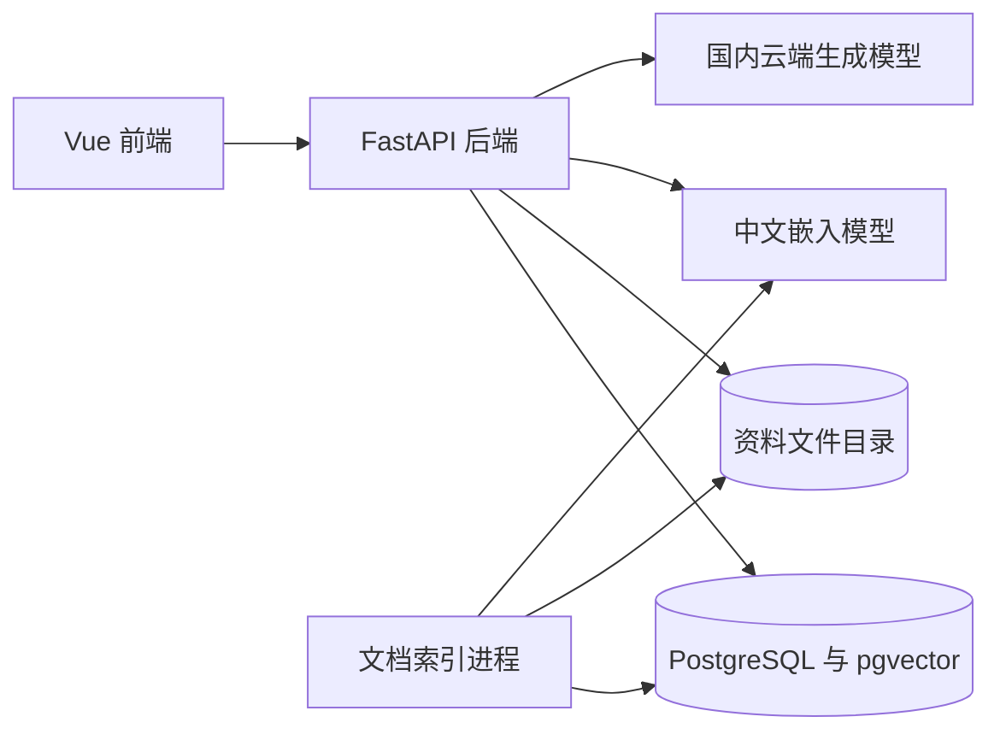

# 基于 RAG 技术的教育机构资源管理系统设计与实现

本科毕业设计 · 需求规格与开发计划 · v1.2

本系统面向单个教育机构。教师上传课程资料，管理员审核并发布资料、管理账号、查看资源与问答统计，学生浏览、下载资料，并用自然语言提出课程相关问题。系统从已发布的资料中检索证据，由云端语言模型据此生成带出处的答案。首版交付可在其他电脑通过 Docker Compose 启动的中文 Web 应用，以及可复现的对照与消融实验。默认提供无需 API 密钥的资料摘录演示，配置国内模型服务后启用真正的 RAG 生成问答。

## 1. 交付范围

| 优先级 | 功能范围 | 验收产物 |
| --- | --- | --- |
| P0 必做 | 登录与角色权限、用户管理、课程分类、资源上传和审核、浏览下载、文档解析和向量入库、带引用问答、证据不足提示、匿名问答日志、基础统计、Docker Compose 快速启动、无密钥演示、云端生成、论文对照与消融实验 | 可运行代码、数据库迁移、演示资料与脚本、测试和实验产物、README |
| P1 有余量再做 | 保存个人问答历史、语义和关键词混合检索、重排模型 | 独立功能和对应测试，逐项交付；混合检索与重排完成后可并入消融实验 |
| 本期范围之外 | 多机构隔离、排课、考试、音视频内容检索、扫描件 OCR、模型微调 | 保留在论文展望 |

实施默认值为单机构、一个人开发，开发六周加一周缓冲，论文写作与开发并行（见第 10 节）。课程资料发布后对机构内全部启用账号可见，无选课和班级权限。初始管理员由种子脚本创建，其余账号由管理员在界面中维护。P0 完成后即可提交和答辩演示。资料使用自编或允许公开分发的文本，示例课程可用《数据库原理》《计算机网络》《Python 程序设计》。资料中应包含本机构特有的内容，例如自编讲义里的案例、课程要求和教师的特定表述，以便实验区分通用知识与机构资料（见第 9 节）。

## 2. 角色与权限

| 操作 | 学生 `student` | 教师 `teacher` | 管理员 `admin` |
| --- | --- | --- | --- |
| 浏览、下载已发布资源 | 可 | 可 | 可 |
| 问答与查看引用 | 可 | 可 | 可 |
| 上传、修改草稿、提交审核 | 无 | 仅本人资源 | 无 |
| 查看未发布资源及原件 | 无 | 仅本人资源 | 可 |
| 通过、驳回、下架资源 | 无 | 无 | 可 |
| 查看资源处理进度 | 无 | 仅本人资源 | 可看全部 |
| 重试失败索引 | 无 | 无 | 可 |
| 新建、改名课程分类 | 无 | 无 | 可 |
| 新建账号、启用停用、重置密码 | 无 | 无 | 可 |
| 查看统计与匿名问答日志 | 无 | 无 | 可 |

所有业务接口均由后端校验登录状态、角色和对象权限。未启用账号的会话不可继续访问，停用账号时同时撤销其全部会话。学生访问未发布资源或其引用时返回 `404`，教师访问他人未发布资源也按此处理。资源下载必须走受鉴权的接口，磁盘文件不得经公共静态路径访问。

## 3. 功能需求与验收

| 编号 | 需求 | 可观察的验收条件 |
| --- | --- | --- |
| AUTH-01 | 用户用账号和密码登录，查看身份并退出 | 三种角色登录后均能访问对应界面；错误凭据返回 `401`；退出后会话无法继续请求 |
| USER-01 | 管理员新建账号、修改角色、启用停用、重置密码 | 用户名重复返回 `409`；停用后该账号原有会话立即失效；管理员不能停用自己，也不能把最后一个启用的管理员改为其他角色 |
| CAT-01 | 管理员创建和改名课程，课程名唯一 | 新建课程可在上传和筛选中选用；重复名称返回 `409` |
| RES-01 | 教师上传资源并编辑本人草稿，必填标题、课程和文件，描述可选 | 支持含文本层 PDF、DOCX、UTF-8 TXT；默认每文件上限 20 MiB；文件不合法返回 `415`，超限返回 `413` |
| RES-02 | 教师提交，管理员通过或填写原因后驳回 | 学生在审核通过前无法浏览、下载；教师可查看驳回原因并重新提交；对非待审资源重复审核返回 `409` |
| RES-03 | 登录用户按标题或描述关键词、课程筛选已发布资料 | 分页和下载可用；默认每页 20，最大 100；顺序为最新发布时间在前，同一时间按 ID 倒序 |
| RES-04 | 管理员下架已发布资料 | 请求成功后新发起的下载、引用打开与问答均无法使用该资料；资源所有者和管理员仍能查看记录 |
| IDX-01 | 审核通过后异步解析、切块、向量化 | 资源可先下载，问答只使用 `ready` 的资源；失败显示原因，管理员重试后无重复片段 |
| QA-01 | 用户输入中文问题，可选限定课程 | 回答含可点击的引用及依据摘录；PDF 引用显示页码，DOCX/TXT 引用显示段落或行号范围 |
| QA-02 | 证据不足、模型故障和权限失效分别处理 | 无证据时返回 `insufficient_evidence`；模型输出不合法返回 `502`，服务不可用返回 `503`，超时返回 `504`；回答返回前重新确认引用可见性 |
| QA-03 | 无密钥时支持资料摘录演示，配置国内服务后支持生成 | 默认模式可检索正文并打开出处，零外部模型调用；切换到云端后使用同一批资料完成生成问答 |
| LOG-01 | 每次问答写入匿名日志 | 日志不含用户标识；记录问题、课程范围、结果状态、命中片段及相似度、各阶段耗时和模型配置；仅管理员可查看 |
| STAT-01 | 管理员查看基础统计 | 展示各课程已发布资源数、审核状态分布、索引状态分布、近 30 天每日问答次数及证据不足占比；数字与数据库查询结果一致 |

### 资源审核与索引状态

- 审核状态使用 `draft → pending → published → archived`，以及 `pending → rejected → draft`。驳回原因必填，教师进入 `draft` 后可编辑标题、课程和描述再提交。首版一个资源对应一个原始文件，上传其他文件时新建资源。已发布资源需要更正时，由教师提交新资源，经审核后由管理员下架旧资源。
- 索引状态独立保存为 `not_indexed → queued → processing → ready`，处理失败进入 `failed`。仅审核状态为 `published` 且索引状态为 `failed` 的资源可由管理员重新排队，已下架资源不可重试。审核通过、记录审核事件及设置 `queued` 在同一事务内提交。
- 下架时保留源文件和已有片段，检索实时过滤审核状态。下架时索引状态为 `ready` 或 `failed` 的保持不变；为 `queued` 或 `processing` 的改为 `not_indexed`，并清空任务令牌和到期时间。工作进程完成时按任务令牌核对，令牌已被清空则放弃本次结果。
- P0 运行一个独立索引进程，通过数据库认领 `queued` 任务并记录任务令牌及到期时间。每次尝试设置最长执行时间，过期后由进程标记 `failed`，可人工重试。完成时在同一事务内按任务令牌核对所有权、替换全部片段并置为 `ready`。失败只保存简要原因，学生界面不展示内部异常细节。
- 扫描件或空白文件索引失败时提示“未提取到可用文本”。学生仍可浏览并下载经审核的源文件，详情页标明该资料暂不可用于问答。

## 4. 技术设计

| 层 | 默认选型与职责 |
| --- | --- |
| 前端 | Vue 3、TypeScript、Vite、Vue Router、Element Plus、ECharts（统计图表）；中文桌面优先页面 |
| 后端 | Python、FastAPI、SQLAlchemy、Alembic；业务 API、权限、下载和问答流程 |
| 数据 | PostgreSQL 与 pgvector；同库保存业务数据和向量，小规模实验用余弦距离精确搜索。 [pgvector 官方文档](https://github.com/pgvector/pgvector#querying) |
| 文件与解析 | 服务端本地持久卷；pypdf 解析 PDF 文本层，python-docx 提取 DOCX 正文段落，UTF-8 解码 TXT。首版提取正文段落，公式、图片和复杂表格不做结构化处理 |
| 嵌入 | Sentence Transformers 在容器内用 CPU 加载 `BAAI/bge-small-zh-v1.5`，输出 512 维向量。把经校验的固定版本和许可文件打包进供 API 与索引进程共用的后端镜像。文档和问题使用相同配置。 [模型卡](https://huggingface.co/BAAI/bge-small-zh-v1.5) |
| 生成 | 首选阿里云百炼北京区 `qwen-flash-2025-07-28`，备选 DeepSeek `deepseek-flash`。后端通过兼容 Chat Completions 的 HTTP 接口调用，由环境变量选择服务商和模型。默认关闭思考和外部工具，使用非流式 JSON Object 输出，后端校验字段与引用。 [百炼模型文档](https://help.aliyun.com/zh/model-studio/qwen-flash) · [DeepSeek JSON 文档](https://api-docs.deepseek.com/zh-cn/guides/json_mode/) |
| 运行 | Docker Compose 统一启动 Web、API、索引进程、数据库与一次性初始化任务。默认无密钥启动资料摘录演示。真实生成需要可联网的云端配置，宿主机只需 Docker Compose 与浏览器 |



### 生成模型技术验证（M1 内完成）

使用独立脚本 `scripts/spike_llm.py` 验证真实 API。按相同提示和证据顺序运行，先验证首选模型，需要备选时再比较 DeepSeek。

1. 从示例资料中手工挑 20 组“问题 + 3–5 个片段”，其中 5 组不含答案。
2. 调用 `/chat/completions`，使用第 7 节的提示词和固定温度。百炼使用北京区业务空间的 `.../compatible-mode/v1` 地址和同区域密钥，并设置 `enable_thinking: false`。DeepSeek 的 Base URL 为 `https://api.deepseek.com`，请求设置 `thinking: {"type": "disabled"}`。 [百炼接入文档](https://help.aliyun.com/zh/model-studio/compatibility-of-openai-with-dashscope) · [百炼思考参数](https://help.aliyun.com/zh/model-studio/deep-thinking) · [DeepSeek 思考参数](https://api-docs.deepseek.com/zh-cn/guides/thinking_mode/)
3. 记录格式及引用编号合规率、可答题正确率、引用支持率、无答案题正确拒答率、延迟和服务商返回的输入与输出 Token。人工逐项对照原文。
4. 筛选参考线为 20 题中至少 18 题通过结构校验、15 道可答题中至少 12 道答对且引用能支撑关键事实、5 道无答案题中至少 4 道正确拒答。记录端到端中位数和最大值。两个候选均达标时优先用预计成本较低的方案。若两者均未达标，先检查提示和上下文，记录调整后结果。

验证结果写入 `docs/decisions.md`，作为论文中模型选型的依据。

### 生成费用估算

以下为 2026 年 11 月 23 日查到的官网价格。按每次 3000 输入 Token、300 输出 Token、不使用缓存或优惠、不重试估算。实际以服务商账单为准，样例入口与自动化测试默认不调用付费 API。

| 候选 | 未缓存输入和输出每百万 Token 单价 | 1000 次估算 |
| --- | --- | --- |
| 百炼北京区 `qwen-flash-2025-07-28`，每次输入不超过 128K | 输入 ¥0.15，输出 ¥1.50。 [百炼模型价格](https://help.aliyun.com/zh/model-studio/qwen-flash) | 约 ¥0.90 |
| DeepSeek `deepseek-flash`，空闲 / 高峰时段 | 输入 ¥1 / ¥2，输出 ¥4 / ¥8。 [DeepSeek 价格](https://api-docs.deepseek.com/zh-cn/quick_start/pricing/) | 约 ¥4.20 / ¥8.40 |

### 目录结构

建议模块目录如下。正式项目的依赖版本在初始化时通过锁文件固定，数据库镜像固定标签。

```text
frontend/              Vue 页面和 API 客户端
backend/app/           登录鉴权、用户、课程、资源、审核、检索、问答、日志和统计
backend/migrations/    数据库迁移
backend/tests/         单元测试和接口集成测试
scripts/               种子数据、索引进程启动、模型技术验证、论文实验入口
data/samples/          可公开分发的教学资料
evaluation/            验证集、测试集、评分规则和评分输出
docs/                  系统设计、设计决策记录、实验报告、答辩演示步骤
README.md              安装、运行、演示和故障排查
compose.yaml           全栈服务、数据库及幂等初始化
.env.example           环境变量示例
```

## 5. 数据模型

| 表 | 核心数据和约束 |
| --- | --- |
| `users` | `id`、唯一 `username`、`display_name`、`password_hash`、`role`、`is_active`、`created_at`、`updated_at`；密码采用成熟的 Argon2id 实现 |
| `sessions` | `id`、唯一 `token_hash`、`user_id`、`expires_at`、`created_at`；数据库仅保存随机会话令牌的哈希 |
| `courses` | `id`、唯一 `name`、可选 `description`、`created_at` |
| `resources` | `id`、`owner_id`、`course_id`、`title`、`description`、`original_filename`、唯一 `storage_key`、`mime_type`、`size_bytes`、`review_status`、`index_status`、`index_error`、`index_attempt_id`、`index_lease_until`、`published_at`、`created_at`、`updated_at` |
| `resource_reviews` | `id`、`resource_id`、`reviewer_id`、`action`、`reason`、`created_at`；记录通过、驳回、下架 |
| `resource_chunks` | `id`、`resource_id`、`chunk_index`、`content`、`locator`、`embedding vector(512)`、`embedding_model`（含版本）、`chunk_config`；`(resource_id, embedding_model, chunk_config, chunk_index)` 唯一。`locator` 保存页码、正文段落或行号范围，`chunk_config` 标识切块规则、长度与重叠 |
| `qa_logs` | `id`、`course_id`（可空）、`question`、`status`、`answer`、`retrieved`（命中片段 ID、相似度和排名的 JSON）、`cited_chunk_ids`、`timings`（检索、生成、总耗时的 JSON）、`model_config`、`created_at`；不保存用户 ID，也不保存拼接后的完整提示词 |

主键统一采用 UUID，时间采用 UTC。数据库对外键、唯一键和状态枚举设约束。资源列表和检索按状态、课程及发布者使用普通索引，切块表对 `resource_id` 建索引，问答日志对 `created_at` 建索引。下架采用状态变更。审核动作锁定对应资源记录并在事务内校验状态，避免多人重复审核。上传以服务端生成的随机 `storage_key` 保存，写入失败须清理临时文件，数据库写入失败须清理本次生成的文件。原始文件名用于展示和下载名称。

## 6. API 与界面约定

统一前缀 `/api/v1`。登录成功后设置 `HttpOnly`、`SameSite=Lax` 的会话 Cookie，默认有效 8 小时，HTTPS 部署启用 `Secure`。开发时通过前端代理保持同源。对修改状态的浏览器请求校验 `Origin` 与配置的前端源。API 失败体统一为 `{"error":{"code":"…","message":"…","request_id":"…"}}`。非法字段或过滤条件使用 `422`，无会话使用 `401`，角色禁止使用 `403`，资源不存在或不可见使用 `404`，非法状态变更使用 `409`。

| 方法和路径 | 用途与契约 |
| --- | --- |
| `POST /auth/login` | JSON `username,password`；返回当前用户身份并设置会话 |
| `POST /auth/logout`、`GET /auth/me` | 撤销会话并清除 Cookie；查询当前 `id,username,display_name,role` |
| `GET /system/mode` | 返回 `qa_mode`（`demo` 或 `cloud`），供前端显示当前模式 |
| `GET /admin/users`、`POST /admin/users`、`PATCH /admin/users/{id}` | 用户列表（可按角色和启用状态筛选）、新建、修改 `display_name,role,is_active`；均限管理员 |
| `POST /admin/users/{id}/reset-password` | JSON `new_password`；重置后撤销该用户全部会话，返回 `204` |
| `GET /courses`、`POST /courses`、`PATCH /courses/{id}` | 列表、创建、更新；写操作限管理员 |
| `GET /resources` | 发布资源列表，接收 `q,course_id,page,page_size`；返回 `items,total,page,page_size` |
| `GET /resources/mine` | 教师本人资源列表，含记录的审核及索引状态 |
| `GET /admin/resources` | 管理员资源列表，可按 `review_status,index_status,course_id` 筛选 |
| `POST /resources`、`PATCH /resources/{id}` | 教师用 multipart `title,course_id,description,file` 上传为草稿，成功返回 `201`；本人草稿元数据用 JSON 修改 |
| `GET /resources/{id}`、`GET /resources/{id}/download` | 资源详情与原件下载，按对象权限判断 |
| `POST /resources/{id}/submit` | 本人草稿送审；被驳回资源先通过 `POST /resources/{id}/revise` 回到草稿 |
| `POST /admin/resources/{id}/review` | JSON 含 `action`（`approve` 或 `reject`）和 `reason`；驳回必须提供原因 |
| `POST /admin/resources/{id}/archive`、`POST /admin/resources/{id}/index/retry` | 下架与重排索引；重试成功返回 `202` |
| `POST /qa/ask` | JSON `question`、可选 `course_id`；去掉首尾空白后限 1–500 字符，返回回答和引用 |
| `GET /resources/{id}/citations/{chunk_id}` | 返回指定、已发布且索引就绪的资料片段及定位；检查片段属于该资源 |
| `GET /admin/stats` | 返回 STAT-01 所列统计数据，接收可选 `days`（默认 30，最大 180） |
| `GET /admin/qa-logs` | 匿名问答日志分页列表，可按 `status,course_id` 和日期范围筛选 |

除下载、退出或另有约定的成功状态外，默认返回 `200` 和 JSON。状态转换接口返回最新资源状态，退出返回 `204`。问答返回以下结构，摘录和定位从数据库构造并以纯文本显示。

```json
{
  "status": "answered",
  "answer": "课程资料将事务隔离性定义为并发事务之间相互隔离。[1]",
  "citations": [
    {
      "number": 1,
      "resource_id": "b0000000-0000-4000-8000-000000000001",
      "chunk_id": "c0000000-0000-4000-8000-000000000001",
      "title": "事务与并发控制",
      "locator": {"type": "pdf_page", "start": 3, "end": 3},
      "excerpt": "隔离性要求并发执行的事务彼此隔离。"
    }
  ]
}
```

证据不足时仍返回 `200`，`status` 为 `insufficient_evidence`、`citations` 为空，回答提示“已发布资料中未找到足够依据”。

前端页面包括：登录页；资源列表与详情；教师的上传与资源管理；管理员的用户管理、课程管理、审核管理、统计页（用 ECharts 展示 STAT-01 数据）和问答日志页；问答页。问答页提供课程范围、加载和错误状态、出处抽屉，引用点击后重新请求片段，抽屉可打开资源详情并提供源文件下载。已显示在浏览器中的旧回答随会话页面保留，点击已下架的出处时显示不可用。

## 7. RAG 实现流程

1. **解析并记录来源。** PDF 按页抽取，页码从 1 开始且分块不跨页。DOCX 按正文段落、TXT 按原始行记录 1 起始的位置。去除空页和无意义空白，保留片段与原文位置的映射。分块不跨页会切断跨页段落，论文中需说明这一取舍，并在失败案例分析中留意由此造成的漏召回。
2. **切分并嵌入。** 默认目标 350 个嵌入模型 token，相邻块重叠 50 个 token，优先沿自然段和句子截断。实际输入需检查模型分词器的上限，查询前缀也计入长度预算。每个片段保存 `embedding_model` 和 `chunk_config`，检索时只使用与当前配置一致的片段。用 `scripts/reindex.py` 为已发布资源补建新配置，仅替换目标配置的片段。确认全部资料已建好新配置后再切换查询配置，然后按需清理旧片段。消融实验的不同切块长度按相同规则并存。
3. **检索。** 先在同一查询限定 `published`、`ready`、匹配的嵌入与切块配置和可选课程，再按余弦距离升序取 Top-K（默认 5），打平时按片段 ID 排序。相似度使用 `1 - cosine_distance`。证据门槛由验证集确定（见第 9 节），无合格片段时直接返回证据不足。bge 系列模型的相似度通常集中在较窄的区间，门槛需要按验证集结果细调，不要直接套用经验值。
4. **准备答复。** 演示模式直接摘录排名靠前的合格片段并标注出处，由前端显示“资料摘录演示”。云端模式在上下文预算内发送用户问题和编号后的证据片段。提示模型把片段作为资料，忽略其中的指令，关键事实附编号。请求使用非流式 `response_format: {"type": "json_object"}`，提示中包含 `JSON` 和字段样例。初始输出限制 512 Token，限制连接与总请求时限。
5. **校验引用并响应。** 云端模型返回 `status`、`answer`、`citation_numbers`。后端检查类型、状态、回答里的编号与数组是否一致、编号是否来自本次证据。出处由数据库构造，返回前重新确认资源仍可见。证据不足或下架时返回 `insufficient_evidence`。结构无效或内容为空返回 `502`，上游鉴权失败、余额不足、限流或服务不可用返回带明确错误码的 `503`，超时返回 `504`。云端错误不自动切换模型，便于复现实验和控制费用。编号校验只能确认来源存在，答案是否得到片段支持在论文实验中逐项评分。
6. **记录日志。** 无论结果如何，问答结束时写入一条 `qa_logs`，记录状态、命中片段、各阶段耗时和模型配置。写日志失败只记应用日志，不影响本次回答返回。

## 8. 非功能需求与测试

- 输入与文件。校验文件扩展名和实际格式，DOCX 限制解包后的大小，PDF 限制页数，解析进程限制执行时间；文件名与文档文字按纯文本显示。默认解析上限 200 页 PDF，索引单次超时 5 分钟，上限写为可配置项。资源目录和模型缓存从 Git 忽略。
- 密码与配置。初始化时生成演示密码并在一次性初始化日志输出，数据库保存密码哈希。云端 API Key 只由后端读取本地环境变量或 Git 忽略的 `.env`，不得进入前端、镜像、普通日志或仓库。PostgreSQL 只在 Compose 私网开放。云端调用仅发送当前问题和必要的证据片段。界面提示云端模式的数据流向，公开演示与论文实验使用自编或允许公开和外发的资料。问答日志不保存用户 ID，界面提示用户勿在提问中填写个人信息。
- 响应与容量。以 30 份资料、1000 个片段、单人演示为首版基准。记录本地 CPU、内存、系统、云端服务商和模型版本。分别记录容器首次就绪耗时、检索耗时、上游调用耗时和端到端延迟，初始生成超时 45 秒。限制单用户云端问答频率及单次输入输出预算，记录供应商返回的 Token 用量。首次启动、健康检查和样例初始化不得触发付费请求。
- 测试覆盖。认证与对象权限、用户停用后的会话撤销、最后一个管理员保护、重复审核、非法状态、文件限制及空正文、索引重试和取消、切块配置隔离、课程过滤、出处校验、证据不足、统计、无密钥启动与云端错误映射。集成测试使用独立 PostgreSQL+pgvector 测试库、临时文件目录和确定性模型替身。真实云端调用和论文实验由显式命令运行。使用模拟响应覆盖 API Key 失效、余额不足、限流、超时、空输出及错误编号。

## 9. 本科论文实验

实验回答两个问题：

- **问题一**：在本机构课程资料问答中，检索课程材料是否改善回答正确性与可溯源性，改善程度是否因题目类型而不同。
- **问题二**：切块长度、Top-K 和证据门槛如何影响检索效果。

使用自编或公开授权的 15–30 份资料，覆盖至少 3 门课程，保存每份资料的来源、授权和版本。以 RAG 原始论文为理论来源，在论文中说明本项目是应用实现，采用预训练嵌入和生成模型。 [Lewis 等人的 RAG 论文](https://arxiv.org/abs/2005.11401)

### 9.1 题集

| 题集 | 题数 | 组成 | 用途 |
| --- | --- | --- | --- |
| 验证集 `validation.jsonl` | 24 | 18 道可答题、6 道无答案题 | 选择 Top-K 和证据门槛，调整提示词 |
| 测试集 `test.jsonl` | 60 | 45 道可答题、15 道无答案题 | 最终对照实验与消融，只运行不调参 |

测试集的 45 道可答题按两个维度标注：

- **知识类型**：通用知识题约 20 道，答案属于课程常识，模型不检索也可能答对，例如“什么是事务的隔离性”；机构资料题约 25 道，答案只存在于本机构资料中，例如自编讲义里的案例数据、课程考核要求、教师在讲义中给出的特定定义或步骤。
- **难度**：直接查证题约 27 道，同义改写或需结合多段证据的题约 18 道。

无答案题应与资料主题相近但资料中确实没有答案，避免模型因话题无关而轻易拒答。每题标注 `question_id`、`course`、`question`、`answerable`、`knowledge_type`（`general` 或 `institutional`）、`difficulty`（`direct` 或 `paraphrase_multi`）、`gold_answer`、`gold_sources`。金标准来源标到页或段落，由人工对照原文确定。出题与标注从 M3 资料定稿后开始，M5 前完成。

### 9.2 实验流程

1. **调参。** 在验证集上比较 K=3、5、8 和若干证据门槛，以可答题 Hit@K 和无答案题拒答率为依据确定最终配置。同时固定切块规则、提示词、数据、生成模型和生成参数。
2. **对照实验（问题一）。** A 组用生成模型直接回答问题，B 组增加检索证据和引用输出。两组共用问题、课程提示、服务商、模型版本、温度、输出长度上限和缺乏依据时承认不确定的基本要求。固定模型快照（若可用），在同一客户端和相近时段运行，保存请求配置、Token 用量与运行日期。两组均显式使用云端模式，自动化测试替身和资料摘录演示不进入实验数据。
3. **检索消融（问题二）。** 在测试集上分别改变一个因素，其余保持最终配置：切块长度 200 / 350 / 500 token（重叠按比例调整）；Top-K 为 3 / 5 / 8；证据门槛为开启和关闭。消融只计算可自动得出的检索指标，不需要人工评分。消融用于分析，不回头修改最终配置。若完成 P1 的混合检索或重排模型，可作为额外一行加入消融表。
4. **人工评分。** 采用盲评：把 A、B 两组的回答打乱顺序，隐藏组别和引用标记后评分正确性；B 组的引用支持度单独评分。请一位同学按同一评分规则独立评测试集中随机抽取的 20 题（两组共 40 份回答），报告两人判定一致的比例，并说明分歧如何处理。评分规则写在 `evaluation/rubric.md`，评分开始前定稿。

### 9.3 指标

| 指标 | 定义 | 适用 |
| --- | --- | --- |
| 答案正确率 | 关键事实完整且无实质错误的可答题数 / 可答题数 | A、B 两组，分别按知识类型和难度报告 |
| 正确拒答率 | 明确说明缺乏依据且未编造事实的无答案题数 / 无答案题数 | A、B 两组 |
| 误拒答率 | 被系统判为证据不足的可答题数 / 可答题数 | B 组 |
| Hit@K | 至少一个金标准位置被召回的可答题数 / 可答题数 | B 组与消融 |
| MRR | 可答题中第一个命中金标准位置的片段排名的倒数的平均值，未命中记 0 | B 组与消融 |
| 引用支持率 | 能够支持对应陈述的引用数 / 系统返回的引用总数 | B 组 |
| 引用覆盖率 | 带至少一个引用的已回答题数 / 已回答题数 | B 组 |
| 延迟 | 检索耗时、云端调用耗时、端到端耗时的中位数和最大值，记录运行时段及首次请求 | A、B 两组 |

片段与金标准位置“命中”的判定为：同一份资料，且片段的 `locator` 范围与金标准页码或段落范围有交集。每个指标都标出题数或分母。题量较小，论文中结论表述为“在本实验条件下观察到”，并说明小样本局限。

### 9.4 产物与失败分析

保存逐题原始输出、命中片段 ID 与位置、耗时、人工评分及汇总表。按以下类别统计 B 组的失败题并各举典型案例：没有召回正确文档；召回正确证据但生成错误；引用编号有效但无法支持陈述；可答题被误判为证据不足；因分块不跨页导致的漏召回。论文报告真实结果，保留评分规则与配置以便复现。

实验入口为 `scripts/run_evaluation.py`，支持指定数据集和 `baseline`、`rag` 两种模式，以及用参数覆盖 Top-K、门槛和切块配置以运行消融。单次运行输出配置、逐题 JSONL、人工评分 CSV 模板及可由评分表重新计算的指标汇总。`scripts/blind_sheet.py` 从两组输出生成打乱顺序的盲评表，评分完成后再按隐藏的映射还原组别。给每份公开资料分配稳定的样例编号，金标准引用该编号和页码或段落，运行时再映射到数据库标识。

## 10. 开发与论文进度

开发共七周，其中第 7 周为缓冲，用于消化云端联调、跨电脑启动验证、调参或评分超时等问题；若前六周按时完成，第 7 周用于完善论文和答辩材料。实施前按学院通知把开题、中期检查、查重和定稿日期填入下表，并检查里程碑是否与之冲突。

| 学院节点 | 日期 | 届时应具备的材料 |
| --- | --- | --- |
| 开题 | 待填 | 本计划、技术验证结果 |
| 中期检查 | 待填 | 可演示的发布闭环与问答原型 |
| 查重 | 待填 | 论文全文 |
| 定稿与答辩 | 待填 | 论文、演示环境、实验产物 |

| 阶段 | 开发任务 | 论文与实验任务 | 进入下一阶段的条件 |
| --- | --- | --- | --- |
| M1 第 1 周 | 初始化目录与依赖、Compose 骨架、数据库迁移、登录会话、初始账号、用户管理、课程分类和云端模型技术验证 | 绪论、相关技术综述初稿 | 空库从 Compose 迁移启动，角色与用户管理接口测试通过，前端能登录。使用授权密钥验证云端候选并记录结果 |
| M2 第 2 周 | 文件上传、资源列表与详情、下载、教师工作台、审核与下架 | 需求分析：用例图、权限矩阵 | 用教师、管理员、学生账号跑完发布闭环，权限与下架用例通过 |
| M3 第 3 周 | PDF/DOCX/TXT 解析、切块、嵌入、索引进程及失败重试 | 定稿实验资料；开始出题与金标准标注；系统设计：架构图、E-R 图、状态图 | 三种合法样例均能入库，片段定位可复查，索引重试不重复；至少完成验证集 |
| M4 第 4 周 | 课程内检索、无密钥摘录演示、云端生成、问答页面、引用抽屉、问答日志、统计页 | 完成测试集标注，定稿评分规则和时序图 | 演示模式无需密钥可使用，云端回答可找到出处，验证跨课程、证据不足、下架与上游故障 |
| M5 第 5 周 | 修复实验中暴露的系统问题 | 验证集调参；运行对照与消融；盲评与第二评分人评分；汇总指标 | 逐题结果、评分表、汇总、一致率和典型失败案例均可复现 |
| M6 第 6 周 | GitHub 发布准备、镜像构建、安装文档、演示步骤、截图 | 系统实现与测试章节、实验分析章节、论文图表 | 使用另一台电脑或干净虚拟机按第 11 节验证两种模式，从干净副本可运行 |
| 第 7 周 缓冲 | 处理遗留问题 | 摘要、结论与展望、全文修改、查重准备 | 论文全文完成，答辩演示彩排一次 |

### 论文章节与本计划对应

| 论文章节 | 主要内容 | 本计划来源 |
| --- | --- | --- |
| 绪论 | 研究背景、教育机构资料管理与问答需求、研究内容 | 开头、第 1 节 |
| 相关技术 | RAG 原理、文本嵌入、向量检索、pgvector、FastAPI、Vue | 第 4、7 节 |
| 需求分析 | 角色、用例图、功能需求、非功能需求 | 第 2、3、8 节 |
| 系统设计 | 架构图、模块划分、E-R 图、审核与索引状态图、接口设计、问答时序图 | 第 3–7 节 |
| 系统实现 | 各模块实现与界面截图、RAG 流程关键代码 | 第 6、7 节 |
| 系统测试 | 测试用例、测试结果 | 第 8 节 |
| 实验与分析 | 实验设计、对照结果、消融结果、失败案例、局限 | 第 9 节 |
| 总结与展望 | 工作总结、不足、本期范围之外的方向 | 第 1 节 |

### 设计决策记录

每个阶段把关键设计选择写入 `docs/decisions.md`，每条写明：问题、备选方案、选择和理由。至少覆盖：会话方式与令牌哈希、密码哈希算法、索引任务的认领和超时机制、审核与索引状态分离的原因、切块参数、证据门槛的确定方法、生成模型选型。答辩时评审常会追问这些设计的理由，这份记录也是论文设计章节的素材。若开发中使用 AI 编程助手，需先确认学院对 AI 辅助的规定，并保证能讲清每个模块的实现。

## 11. GitHub 交付与接手方式

### 另一台电脑的启动验收

1. 电脑装好 Docker Compose，能拉取所需镜像。在正式发布的 GitHub 仓库中，克隆后进入目录执行 `docker compose up -d`。默认 Compose 使用已发布且固定版本的项目镜像，另提供从源码构建的 Compose 覆盖文件。预构建镜像包含固定版本嵌入模型，使用者首次启动时无需另行下载模型文件或安装 Python、Node.js、数据库和推理服务。
2. Compose 等待数据库可用，执行迁移与幂等初始化，生成三类演示账号，导入并索引可公开资料。通过 `docker compose logs init` 获取本地演示账号与交给索引进程的任务状态。浏览器访问 `http://localhost:8080`，可使用三种角色走上传、审核、浏览和下载流程。样例索引就绪后可提问、打开出处，并验证无证据提示。默认只绑定本机回环地址。重复启动不重复创建账号或样例。
3. 云端模式下，使用者开通自己的国内服务商账号，将 `.env.example` 复制为 `.env` 并设置 `QA_MODE=cloud`、`LLM_PROVIDER=bailian`、`LLM_BASE_URL`、`LLM_API_KEY`，`LLM_MODEL` 默认 `qwen-flash-2025-07-28`。再次执行 `docker compose up -d` 使后端加载配置。验证已导入的同一批样例能走真实生成和引用校验。云端模式配置缺失时应给出可诊断提示，资源管理仍可访问。

如果希望评审老师在浏览器里直接体验云端问答，可另行部署受控演示站，由部署者在服务端配置密钥、鉴权、调用限流和费用上限。仓库版的本地演示账号由初始化任务生成，使用者无需注册模型平台账号。

README 应说明镜像拉取前提、两种模式与故障提示、如何获取北京区密钥、环境变量、样例账号、迁移与重置、模型验证、测试和实验命令，提供 Windows PowerShell 示例。核心配置包含 `QA_MODE`、`LLM_PROVIDER`、`LLM_BASE_URL`、`LLM_API_KEY`、`LLM_MODEL`、`CHAT_TIMEOUT_SECONDS`、`RAG_TOP_K`、`RAG_MIN_SIMILARITY`、`DATABASE_URL`、`EMBEDDING_MODEL`、`CHUNK_SIZE`、`CHUNK_OVERLAP`。演示模式无需 `.env`。

仓库包含源码、固定依赖、迁移、Compose 配置、空密钥的 `.env.example`、许可明确的样例与标注、测试和论文实验说明。真实 `.env`、本地数据、上传文件、模型权重、含个人信息的日志和授权不明的资料通过 `.gitignore` 与发布检查排除。经授权可再分发的嵌入模型文件随镜像分发，并随附许可。

答辩依次展示教师上传并送审、管理员审核、学生下载、真实云端回答和引用、无答案提示、下架后引用失效，以及对照与消融实验结果。网络不可用时用本机资料摘录演示展示检索、权限和出处流程，并使用已保存的真实云端实验结果讲解生成效果。

将下列指令与本文件一起交给接手开发者，可从第一阶段开始实施。

> 阅读 `DEVELOPMENT_PLAN.md` 并检查当前仓库。按 M1 到 M6 的顺序实现 P0。先完成前后端和 Compose 骨架、数据库迁移、账号初始化、登录鉴权、用户管理、课程分类，以及第 4 节的云端模型验证脚本。用确定性替身跑自动化测试，拿到服务商密钥后再显式运行真实调用。记录实际改动、命令、结果与剩余事项，并把设计决策写入 `docs/decisions.md`。每阶段核对空库启动及相关测试，M6 按第 11 节在干净环境验收无密钥演示与云端模式。

## 修订记录

| 版本 | 主要变更 |
| --- | --- |
| v1.0 | 初稿 |
| v1.1 | 实验：测试集扩到 60 题并按知识类型和难度分层，验证集扩到 24 题，增加检索消融、MRR、误拒答率、盲评和第二评分人一致率。技术：M1 增加生成模型技术验证，改用 Ollama JSON Schema 约束输出，切块配置随片段保存以替代停服重建。范围：用户管理、匿名问答日志和基础统计提升为 P0，P1 增加重排模型。进度：增加缓冲周、论文并行任务、学院节点表、论文章节对应表和设计决策记录。修正：RES-04 改为“资源所有者和管理员”可查看记录，明确下架时的索引状态和重试条件 |
| v1.2 | 默认使用国内云端生成候选，增加无密钥摘录演示与跨电脑 Compose 验收，补充价格估算、云端错误映射、数据流与实验用量记录。修正多套索引配置并存时的唯一约束 |
