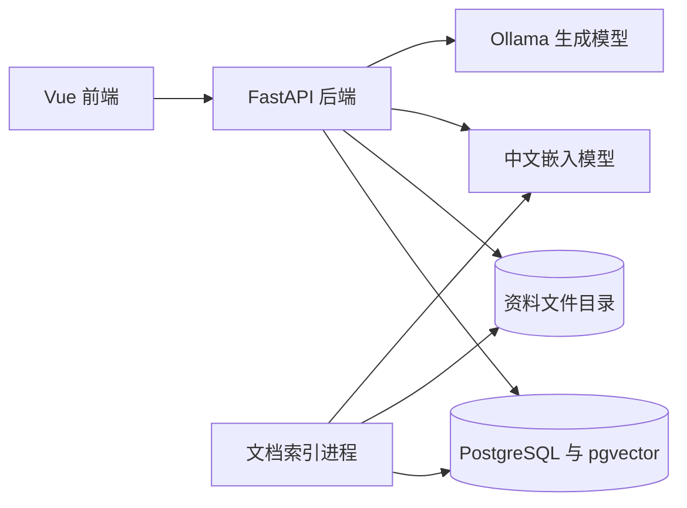

# 基于 RAG 技术的教育机构资源管理系统设计与实现

本科毕业设计 · 需求规格与开发计划 · v1.0

本系统面向单个教育机构。教师上传课程资料，管理员审核并发布资料，学生浏览、下载资料，并用自然语言提出课程相关问题。系统通过检索增强生成（RAG）从已发布的资料中找出相关片段，再让语言模型依据片段回答，并提供可点击的出处。首版交付一个能在本地运行、能从头演示、能复现实验的中文 Web 应用。

## 1. 交付范围

| 优先级 | 功能范围 | 验收产物 |
| --- | --- | --- |
| P0 必做 | 登录与角色权限、课程分类、资源上传和审核、浏览下载、文档解析和向量入库、带引用问答、证据不足提示、测试、论文对照实验 | 可运行代码、数据库迁移、演示资料与脚本、测试和实验产物、README |
| P1 有余量再做 | 保存个人问答历史、语义和关键词混合检索、教学资源统计 | 独立功能和对应测试，逐项交付 |
| 本期范围之外 | 多机构隔离、排课、考试、音视频内容检索、扫描件 OCR、模型微调 | 保留在论文展望 |

实施默认值为单机构、一个人开发、约六周；课程资料发布后对机构内全部启用账号可见，无选课和班级权限。账号由种子脚本或管理员管理命令维护。P0 完成后即可提交和答辩演示。资料使用自编或允许公开分发的文本，示例课程可用《数据库原理》《计算机网络》《Python 程序设计》。

## 2. 角色与权限

| 操作 | 学生 `student` | 教师 `teacher` | 管理员 `admin` |
| --- | --- | --- | --- |
| 浏览、下载已发布资源 | 可 | 可 | 可 |
| 问答与查看引用 | 可 | 可 | 可 |
| 上传、修改草稿、提交审核 | 无 | 仅本人资源 | 无 |
| 查看未发布资源及原件 | 无 | 仅本人资源 | 可 |
| 通过、驳回、下架资源 | 无 | 无 | 可 |
| 查看资源处理进度 | 无 | 仅本人资源 | 可看全部 |
| 重试失败索引 | 无 | 无 | 可 |
| 新建、改名课程分类 | 无 | 无 | 可 |

所有业务接口均由后端校验登录状态、角色和对象权限。未启用账号的会话不可继续访问。学生访问未发布资源或其引用时返回 `404`，教师访问他人未发布资源也按此处理。资源下载必须走受鉴权的接口，磁盘文件不得经公共静态路径访问。

## 3. 功能需求与验收

| 编号 | 需求 | 可观察的验收条件 |
| --- | --- | --- |
| AUTH-01 | 用户用账号和密码登录，查看身份并退出 | 三种角色登录后均能访问对应界面；错误凭据返回 `401`；退出后会话无法继续请求 |
| CAT-01 | 管理员创建和改名课程，课程名唯一 | 新建课程可在上传和筛选中选用；重复名称返回 `409` |
| RES-01 | 教师上传资源并编辑本人草稿，必填标题、课程和文件，描述可选 | 支持含文本层 PDF、DOCX、UTF-8 TXT；默认每文件上限 20 MiB；文件不合法返回 `415`，超限返回 `413` |
| RES-02 | 教师提交，管理员通过或填写原因后驳回 | 学生在审核通过前无法浏览、下载；教师可查看驳回原因并重新提交；对非待审资源重复审核返回 `409` |
| RES-03 | 登录用户按标题或描述关键词、课程筛选已发布资料 | 分页和下载可用；默认每页 20，最大 100；顺序为最新发布时间在前，同一时间按 ID 倒序 |
| RES-04 | 管理员下架已发布资料 | 请求成功后新发起的下载、引用打开与问答均无法使用该资料；教师和管理员仍能查看记录 |
| IDX-01 | 审核通过后异步解析、切块、向量化 | 资源可先下载，问答只使用 `ready` 的资源；失败显示原因，管理员重试后无重复片段 |
| QA-01 | 用户输入中文问题，可选限定课程 | 回答含可点击的引用及依据摘录；PDF 引用显示页码，DOCX/TXT 引用显示段落或行号范围 |
| QA-02 | 证据不足、模型故障和权限失效分别处理 | 无证据时返回 `insufficient_evidence`；模型服务不可用时返回 `503` 或 `504`；回答返回前重新确认引用可见性 |

### 资源审核与索引状态

- 审核状态使用 `draft → pending → published → archived`，以及 `pending → rejected → draft`。驳回原因必填，教师进入 `draft` 后可编辑标题、课程和描述再提交。首版一个资源对应一个原始文件，上传其他文件时新建资源。已发布资源需要更正时，由教师提交新资源，经审核后由管理员下架旧资源。
- 索引状态独立保存为 `not_indexed → queued → processing → ready`，处理失败进入 `failed`。仅已发布的失败资源可由管理员重新排队。审核通过、记录审核事件及设置 `queued` 在同一事务内提交。下架保留源文件和以前的片段，检索实时过滤审核状态，工作进程完成时再次检查 `published`，并在归档时取消或清空未完成的处理状态。
- P0 运行一个独立索引进程，通过数据库认领 `queued` 任务并记录任务令牌及到期时间。每次尝试设置最长执行时间，过期后由进程标记 `failed`，可人工重试。完成时在同一事务内按任务令牌核对所有权、替换全部片段并置为 `ready`。失败只保存简要原因，学生界面不展示内部异常细节。
- 扫描件或空白文件索引失败时提示“未提取到可用文本”。学生仍可浏览并下载经审核的源文件，详情页标明该资料暂不可用于问答。

## 4. 技术设计

| 层 | 默认选型与职责 |
| --- | --- |
| 前端 | Vue 3、TypeScript、Vite、Vue Router、Element Plus；中文桌面优先页面 |
| 后端 | Python、FastAPI、SQLAlchemy、Alembic；业务 API、权限、下载和问答流程 |
| 数据 | PostgreSQL 与 pgvector；同库保存业务数据和向量，小规模实验用余弦距离精确搜索。 [pgvector 官方文档](https://github.com/pgvector/pgvector#querying) |
| 文件与解析 | 服务端本地持久卷；pypdf 解析 PDF 文本层，python-docx 提取 DOCX 正文段落，UTF-8 解码 TXT。首版提取正文段落，公式、图片和复杂表格不做结构化处理 |
| 嵌入 | Sentence Transformers 加载 `BAAI/bge-small-zh-v1.5`；输出 512 维向量，文档和问题使用同一模型版本及一致的配置。 [模型卡](https://huggingface.co/BAAI/bge-small-zh-v1.5) |
| 生成 | Ollama 本地 `/api/chat`，以 `qwen2.5:3b` 作为起始配置。通过环境变量选择模型，首次运行记录实测模型、版本和硬件。 [Ollama 接口文档](https://docs.ollama.com/api/chat)、[模型页](https://ollama.com/library/qwen2.5:3b) |
| 运行 | Docker Compose 管理数据库。前端、API、索引进程和 Ollama 可在宿主机启动。README 提供 Windows PowerShell 命令、迁移和初始化步骤 |



建议模块目录如下。正式项目的依赖版本在初始化时通过锁文件固定，数据库镜像固定标签。

```text
frontend/              Vue 页面和 API 客户端
backend/app/           登录鉴权、课程、资源、审核、检索和问答
backend/migrations/    数据库迁移
backend/tests/         单元测试和接口集成测试
scripts/               种子数据、索引进程启动、论文实验入口
data/samples/          可公开分发的教学资料
evaluation/           验证集、测试集和评分输出说明
docs/                  系统设计、实验报告、答辩演示步骤
README.md              安装、运行、演示和故障排查
compose.yaml           PostgreSQL 与 pgvector
.env.example          环境变量示例
```

## 5. 数据模型

| 表 | 核心数据和约束 |
| --- | --- |
| `users` | `id`、唯一 `username`、`password_hash`、`role`、`is_active`、`created_at`；密码采用成熟的 Argon2id 实现 |
| `sessions` | `id`、唯一 `token_hash`、`user_id`、`expires_at`、`created_at`；数据库仅保存随机会话令牌的哈希 |
| `courses` | `id`、唯一 `name`、可选 `description`、`created_at` |
| `resources` | `id`、`owner_id`、`course_id`、`title`、`description`、`original_filename`、唯一 `storage_key`、`mime_type`、`size_bytes`、`review_status`、`index_status`、`index_error`、`index_attempt_id`、`index_lease_until`、`published_at`、`created_at`、`updated_at` |
| `resource_reviews` | `id`、`resource_id`、`reviewer_id`、`action`、`reason`、`created_at`；记录通过、驳回、下架 |
| `resource_chunks` | `id`、`resource_id`、`chunk_index`、`content`、`locator`、`embedding vector(512)`、`embedding_model`；`(resource_id, chunk_index)` 唯一，`locator` 保存页码、正文段落或行号范围 |

主键统一采用 UUID，时间采用 UTC。数据库对外键、唯一键和状态枚举设约束。资源列表和检索按状态、课程及发布者使用普通索引，切块表对 `resource_id` 建索引。下架采用状态变更。审核动作锁定对应资源记录并在事务内校验状态，避免多人重复审核。上传以服务端生成的随机 `storage_key` 保存，写入失败须清理临时文件，数据库写入失败须清理本次生成的文件。原始文件名用于展示和下载名称。

## 6. API 与界面约定

统一前缀 `/api/v1`。登录成功后设置 `HttpOnly`、`SameSite=Lax` 的会话 Cookie，默认有效 8 小时，HTTPS 部署启用 `Secure`。开发时通过前端代理保持同源。对修改状态的浏览器请求校验 `Origin` 与配置的前端源。API 失败体统一为 `{"error":{"code":"…","message":"…","request_id":"…"}}`。非法字段或过滤条件使用 `422`，无会话使用 `401`，角色禁止使用 `403`，资源不存在或不可见使用 `404`，非法状态变更使用 `409`。

| 方法和路径 | 用途与契约 |
| --- | --- |
| `POST /auth/login` | JSON `username,password`；返回当前用户身份并设置会话 |
| `POST /auth/logout`、`GET /auth/me` | 撤销会话并清除 Cookie；查询当前 `id,username,role` |
| `GET /courses`、`POST /courses`、`PATCH /courses/{id}` | 列表、创建、更新；写操作限管理员 |
| `GET /resources` | 发布资源列表，接收 `q,course_id,page,page_size`；返回 `items,total,page,page_size` |
| `GET /resources/mine` | 教师本人资源列表，含记录的审核及索引状态 |
| `GET /admin/resources` | 管理员资源列表，可按 `review_status,index_status,course_id` 筛选 |
| `POST /resources`、`PATCH /resources/{id}` | 教师用 multipart `title,course_id,description,file` 上传为草稿，成功返回 `201`；本人草稿元数据用 JSON 修改 |
| `GET /resources/{id}`、`GET /resources/{id}/download` | 资源详情与原件下载，按对象权限判断 |
| `POST /resources/{id}/submit` | 本人草稿送审；被驳回资源先通过 `POST /resources/{id}/revise` 回到草稿 |
| `POST /admin/resources/{id}/review` | JSON 含 `action`（`approve` 或 `reject`）和 `reason`；驳回必须提供原因 |
| `POST /admin/resources/{id}/archive`、`POST /admin/resources/{id}/index/retry` | 下架与重排索引；重试成功返回 `202` |
| `POST /qa/ask` | JSON `question`、可选 `course_id`；去掉首尾空白后限 1–500 字符，返回回答和引用 |
| `GET /resources/{id}/citations/{chunk_id}` | 返回指定、已发布且索引就绪的资料片段及定位；检查片段属于该资源 |

除下载、退出或另有约定的成功状态外，默认返回 `200` 和 JSON。状态转换接口返回最新资源状态，退出返回 `204`。问答返回以下结构，摘录和定位从数据库构造并以纯文本显示。

```json
{
  "status": "answered",
  "answer": "课程资料将事务隔离性定义为并发事务之间相互隔离。[1]",
  "citations": [
    {
      "number": 1,
      "resource_id": "b0000000-0000-4000-8000-000000000001",
      "chunk_id": "c0000000-0000-4000-8000-000000000001",
      "title": "事务与并发控制",
      "locator": {"type": "pdf_page", "start": 3, "end": 3},
      "excerpt": "隔离性要求并发执行的事务彼此隔离。"
    }
  ]
}
```

证据不足时仍返回 `200`，`status` 为 `insufficient_evidence`、`citations` 为空，回答提示“已发布资料中未找到足够依据”。前端包含登录页、资源列表与详情、教师的上传与资源管理、管理员的课程与审核管理、问答页。问答页提供课程范围、加载和错误状态、出处抽屉，引用点击后重新请求片段，抽屉可打开资源详情并提供源文件下载。已显示在浏览器中的旧回答随会话页面保留，点击已下架的出处时显示不可用。

## 7. RAG 实现流程

1. **解析并记录来源。** PDF 按页抽取，页码从 1 开始且分块不跨页。DOCX 按正文段落、TXT 按原始行记录 1 起始的位置。去除空页和无意义空白，保留片段与原文位置的映射。
2. **切分并嵌入。** 默认目标 350 个嵌入模型 token，相邻块重叠 50 个 token，优先沿自然段和句子截断。实际输入需检查模型分词器的上限，查询前缀也计入长度预算。存储模型标识与版本；若变更模型或切块策略，先停止问答服务，再清除旧片段、重建、验证后开启问答，避免新旧向量混用。同为 512 维的模型也需重建。
3. **检索。** 先在同一查询限定 `published`、`ready`、匹配的嵌入配置和可选课程，再按余弦距离升序取 Top-5，打平时按片段 ID 排序。通过验证集确定证据门槛，并记录试验值；相似度使用 `1 - cosine_distance`。无合格片段时直接返回证据不足。
4. **构造上下文并生成。** 在模型上下文预算内按排序加入片段，为每条证据编号。提示模型把片段当作参考资料，忽略资料中出现的指令，关键事实附编号，缺乏证据时直接说明。使用非流式结构化输出，限制生成长度，并配置连接超时与总请求时限。
5. **校验引用并响应。** 后端检查回答结构、标记编号和随附引用是否对应本次供给的片段，所有返回的出处必须来自数据库。引用无效、回答缺失或证据被下架时返回证据不足；模型服务连接或服务端错误返回 `503`、超时返回 `504`。编号校验只能确认来源存在，答案能否由片段支持在论文实验中逐项评分。

## 8. 非功能需求与测试

- 输入与文件。校验文件扩展名和实际格式，DOCX 限制解包后的大小，PDF 限制页数，解析进程限制执行时间；文件名与文档文字按纯文本显示。默认解析上限 200 页 PDF，索引单次超时 5 分钟，上限写为可配置项。资源目录和模型缓存从 Git 忽略。
- 密码与配置。示例配置无真实凭据；初始化命令从环境变量读演示密码或现场生成。PostgreSQL 和模型服务仅在本机或私有网络开放。日志记录请求 ID、阶段耗时、资源 ID 与错误分类，避免写入口令、源文全文及完整问答上下文。
- 响应与容量。以 30 份资料、1000 个片段、单人演示为首版基准。在论文中列出实测 CPU、内存、系统及模型，分别记录冷启动、热启动和端到端延迟，初始生成超时 60 秒，可根据实测调整。模型或数据库未启动时界面应显示可理解的错误。
- 测试覆盖。认证与所有者权限；重复审核和非法状态；文件超限、格式不匹配、空正文；索引失败重试与幂等；未审核、未就绪和下架资源排除；课程过滤；引用属于当前命中文档；非法引用拒绝；无知识回答；模型不可用。集成测试使用独立 PostgreSQL+pgvector 测试库、临时文件目录和确定性模型替身；真实 Ollama 与嵌入模型另跑一次完整演示和论文实验。

## 9. 本科论文实验

实验问题为“在本机构课程资料问答中，检索课程材料是否改善回答正确性与可溯源性”。使用自编或公开授权的 15–30 份资料，覆盖至少 3 门课程，保存每份资料的来源、授权和版本。以 RAG 原始论文为理论来源，在论文中说明本项目是应用实现，采用预训练嵌入和生成模型。 [Lewis 等人的 RAG 论文](https://arxiv.org/abs/2005.11401)

1. 准备 10 道调参验证题和 30 道独立测试题。测试题建议含 15 道直接查证、8 道同义改写或需结合多段证据的题、7 道资料库无答案题。标注 `question_id`、`course`、`question`、`answerable`、`gold_answer`、`gold_sources`；金标准来源标到页或段落，由人工对照原文确定。
2. 用验证集选择 Top-K 和阈值的最终配置，例如比较 K=3 与 K=5。固定切块规则、提示词、数据、生成模型和生成参数后再运行测试集。测试集结果用于分析，不用于反复选择参数。
3. A 组用相同生成模型直接回答问题，B 组增加检索证据和引用输出。两组共用问题、课程提示、模型版本、温度、输出长度上限和缺乏依据时承认不确定的基本要求。记录运行配置和模型可用的随机种子，同机运行并记录冷热状态。
4. 两组比较可答题答案正确率、无答案题正确拒答率及端到端延迟。答案按关键事实是否完整且无实质错误人工判定；不可答题明确说明缺乏依据且无编造事实记为正确。B 组另报告 Hit@K（可答题中至少一个金标准位置被召回的题数 / 可答题总数）和引用支持率（能够支持对应陈述的引用数 / 系统返回的引用总数）。同时记录有引用的回答覆盖率和检索耗时，标出各指标的题数或分母。
5. 保存逐题原始输出、命中片段 ID 与位置、耗时、人工评分及汇总表。对照常见失败情况，例如没有召回正确文档、召回正确证据但生成错误、引用编号有效但无法支持陈述。论文报告真实结果和小样本局限，保留评分规则与配置以便复现。

实验入口建议为 `scripts/run_evaluation.py`，支持指定数据集和 `baseline`、`rag` 两种模式。题集保存为 `evaluation/validation.jsonl` 和 `evaluation/test.jsonl`。单次运行输出配置、逐题 JSONL、人工评分 CSV 模板及可由评分表重新计算的指标汇总。给每份公开资料分配稳定的样例编号，金标准引用该编号和页码或段落，运行时再映射到数据库标识。

## 10. 开发里程碑

| 阶段 | 实施任务 | 进入下一阶段的条件 |
| --- | --- | --- |
| M1 第 1 周 | 初始化目录与依赖、数据库、迁移、登录和会话、三角色种子账号、课程分类 | 空库可从迁移启动，角色接口测试通过，前端能登录 |
| M2 第 2 周 | 文件上传、资源列表与详情、下载、教师工作台、审核与下架 | 用教师、管理员、学生账号跑完发布闭环，权限与下架用例通过 |
| M3 第 3 周 | PDF/DOCX/TXT 解析、切块、嵌入、索引进程及失败重试 | 三种合法样例均能入库，片段定位可复查，索引重试不重复 |
| M4 第 4 周 | 课程内检索、Ollama 生成、问答页面、引用抽屉和证据不足处理 | 实际模型回答可找到原文，验证跨课程过滤、不可答和下架场景 |
| M5 第 5 周 | 固定测试集与评分规则、运行 A/B 对照、修复系统问题 | 逐题结果、评分表、汇总和典型失败案例均可复现 |
| M6 第 6 周 | GitHub 发布准备、安装文档、演示步骤、截图和论文图表 | 从干净副本按 README 成功运行，演示流程顺畅，仓库内容可公开 |

## 11. GitHub 交付与接手方式

- README 应覆盖架构、前置软件、依赖安装、首次模型下载、环境变量、数据库迁移、种子初始化、各进程启动、测试与实验入口；给出可以实际复制执行的 Windows PowerShell 命令。建议设置 `DATABASE_URL`、`SESSION_TTL_HOURS`、`APP_ORIGIN`、`UPLOAD_DIR`、`MAX_UPLOAD_BYTES`、`EMBEDDING_MODEL`、`OLLAMA_BASE_URL`、`CHAT_MODEL`、`RAG_TOP_K`、`RAG_MIN_SIMILARITY` 与 `CHAT_TIMEOUT_SECONDS`。
- 仓库包含源代码、固定依赖或锁文件、迁移、`.env.example`、少量可分发样例与标注、测试、实验运行说明、论文所需系统图和演示步骤。公开前检查 `.gitignore`，排除真实 `.env`、本地数据库、上传文件、模型权重、含学生身份的记录以及授权不明的资料。
- 答辩按“教师上传并送审 → 管理员审核 → 索引就绪 → 学生浏览及下载 → 提问并打开引用 → 管理员下架 → 重新提问与点击引用验证失效 → 展示 A/B 实验结果”的顺序进行。使用公开样例展示至少一个可答题和一个无答案题。

将下列指令与本文件一起交给接手模型，可从第一阶段开始实施。

> 阅读 `DEVELOPMENT_PLAN.md` 并检查当前仓库。按 M1 到 M6 的顺序实现 P0。当前先完成 M1，包括前后端骨架、数据库迁移、三角色初始化、登录鉴权和课程分类。运行本阶段验收，报告实际改动、执行命令、结果和剩余事项。接续开发时先核对已完成的验收，用本文的状态、权限和接口约定衔接下一阶段。使用生成或授权的示例数据，保留可复现的运行命令；每阶段提交前检查能否从空数据库初始化并运行涉及的测试。
